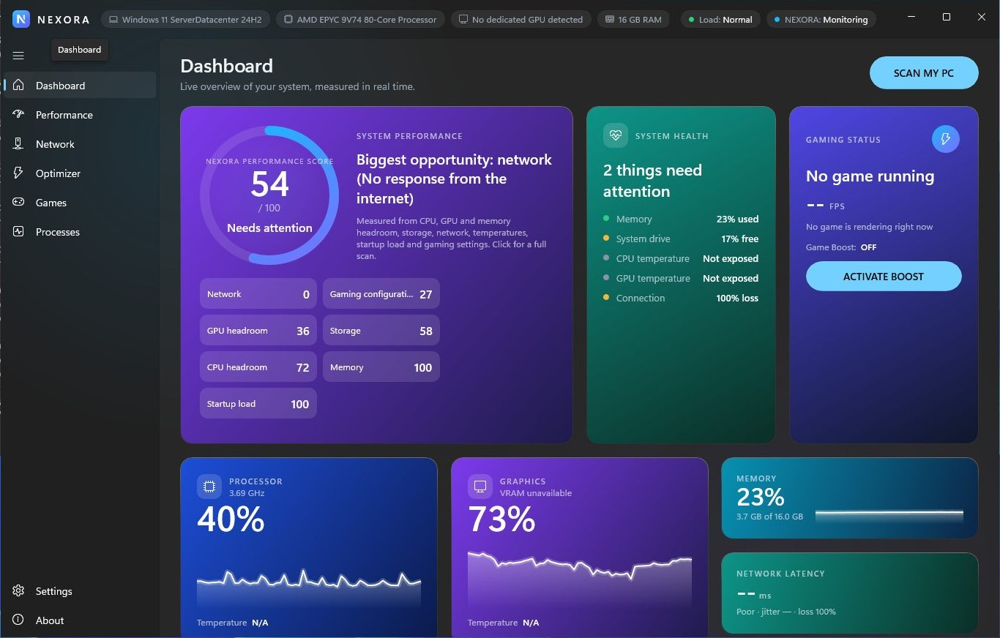
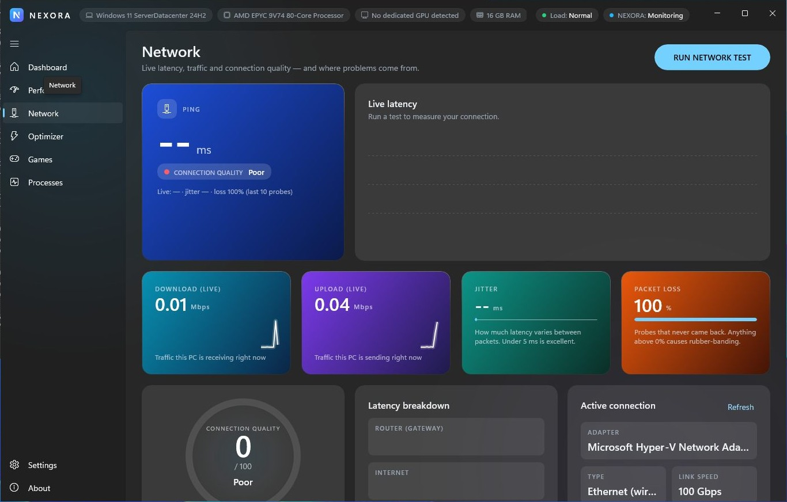
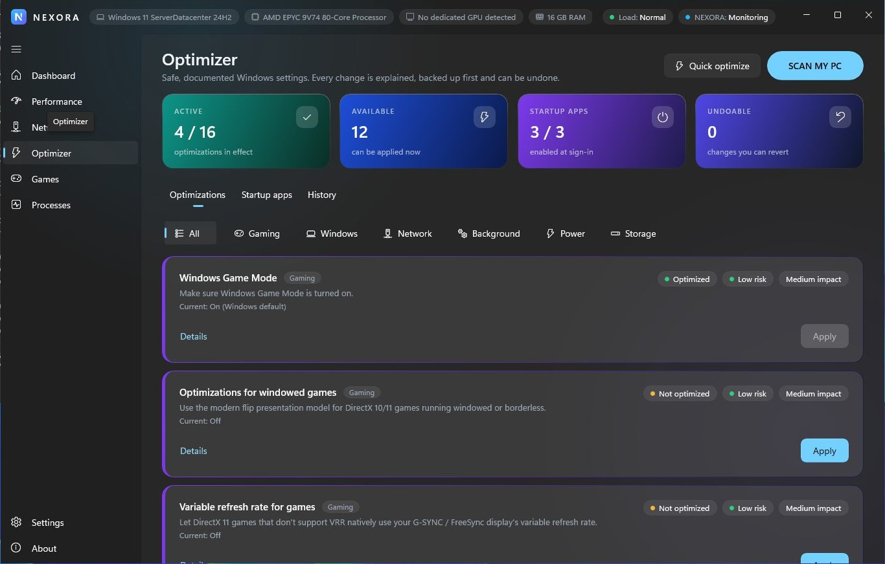

# NEXORA

**Optimize. Measure. Dominate.**

NEXORA is a native Windows 11 performance optimization and gaming diagnostics application built with
C#, .NET 10, WinUI 3 and the Windows App SDK. It measures real FPS, frame times, hardware load and network
quality, and applies only safe, documented, fully reversible Windows optimizations.



| Network analytics | Optimizer |
| --- | --- |
|  |  |

---

## Features

| Area | What NEXORA does |
| --- | --- |
| **Design** | Responsive 12-column bento grid (`Controls/BentoGrid.cs`) with large, medium and compact cards, colour identities per section (blue, cyan, purple, teal, indigo, orange for warnings), glowing charts, hover lift, press feedback and click-to-navigate cards, cinematic startup animation. |
| **Dashboard** | Live CPU / GPU / RAM / latency cards with sparklines, live FPS, temperatures and the *NEXORA Performance Score* (0–100), computed only from measured data. |
| **Performance** | Live FPS + frame-time graphs (ETW present events, no injection), CPU/GPU usage, CPU/GPU frequency, VRAM, temperatures, top resource consumers, and timed performance tests with **Average FPS, 1 % low, 0.1 % low, average frame time, CPU/GPU/RAM** and plain-language insights. |
| **Network** | DNS benchmark (your DNS vs Cloudflare, Google, Quad9, OpenDNS), ping, jitter, packet loss, gateway (router) latency, internet latency, DNS resolver latency (direct UDP query, bypasses cache), stability score, connection quality, latency graph, adapter details (Wi-Fi vs Ethernet, link speed, signal, gateway, DNS) and an honest diagnosis of where problems originate. |
| **Game Boost** | One click switches on the session gaming tweaks and remembers exactly what it changed; turning it off restores everything. Can start automatically when a game is detected. |
| **Smart game detection** | Recognizes games from your profiles when they start: FPS capture follows the game, profile priority is applied, optional auto-Boost; all undone when the game closes. |
| **In-game overlay** | Always-on-top FPS, frame time, CPU, GPU, RAM and ping for borderless/windowed games. Toggle with **Ctrl+Shift+F10** or the tray. |
| **Performance report** | Before/after comparison of two measured tests: average FPS, 1 % lows, frametime stability, network latency, resource usage. Differences within run-to-run variation are reported as "No real change". |
| **Bottleneck detection** | Live and per-test explanation of whether the GPU, CPU, RAM, VRAM, heat or a frame cap limits performance. |
| **Optimizer** | 17 curated optimizations in 6 categories plus per-app startup control. The advisor recommends only what makes sense for the detected PC (GPU type, battery, free space, Wi-Fi) and explains why. Each item shows *what it changes*, *why it may help*, *expected benefit*, *risk*, *current status*, **Apply** and **Undo**. Includes **SCAN MY PC**, Quick Optimize, Optimization History and *Restore previous configuration*. |
| **Games** | Detects Steam, Epic Games, GOG, Riot (VALORANT, League) and Minecraft Launcher installs; custom games via file picker. Per-game profile: launch arguments, optimization profile, priority, monitoring, auto-revert on exit. |
| **Processes** | Live process list (CPU, memory, GPU, priority, status) with search/sort, safe **End process** (with confirmation) and priority changes. Critical Windows processes, services and security software are protected. |
| **Settings** | Theme (dark/light/system), accent color, animations, hardware acceleration (Mica), start with Windows, start minimized, minimize/close to tray, notifications, monitoring interval, background monitoring, FPS capture, network monitoring, optimization preferences. |
| **Tray** | Open NEXORA · Performance Monitor · Network Monitor · Quick Optimize · Exit. |

### The optimization catalog

| Category | Optimization | Risk | Admin |
| --- | --- | --- | --- |
| Gaming | Windows Game Mode | Low | – |
| Gaming | Optimizations for windowed games (Win 11 22H2+) | Low | – |
| Gaming | Disable background game recording ("Record what happened") | Low | – |
| Gaming | Hardware-accelerated GPU scheduling (only if the driver supports it) | Medium | ✔ (restart) |
| Gaming | Disable *Enhance pointer precision* (optional, never auto-selected) | Low | – |
| Gaming | Variable refresh rate for games | Low | – |
| Gaming | Disable Sticky Keys / Filter Keys / Toggle Keys pop-ups | Low | – |
| Gaming | Controller Xbox button doesn't open Game Bar | Low | – |
| Power | High performance plan, or Windows 11 *Best performance* power mode | Low | – |
| Windows | Turn off transparency effects | Low | – |
| Windows | Reduce Windows animation effects | Low | – |
| Windows | Remove startup app delay | Low | – |
| Windows | Turn off Windows tips and suggestions | Low | – |
| Windows | Faster menus | Low | – |
| Network | Limit update peer-sharing to the local network (Delivery Optimization policy) | Low | ✔ |
| Storage | Clean temporary files (quarantined for 7 days, undoable) | Low | – |
| Storage | Turn on Storage Sense | Low | – |
| Background | Disable individual startup apps (Task Manager mechanism) | Low | HKLM entries only |

NEXORA **never** disables Windows services, security software or Windows Update, never edits undocumented
registry tweaks, and never promises FPS or ping gains.

### Safety model

1. The current state is read and shown.
2. The change is explained; medium-risk and batch changes always require confirmation.
3. A **backup of every affected value is written to disk before anything changes**.
4. The change is applied and **verified**. If verification or any step fails, the backup is restored
   automatically (and, optionally, the whole batch is rolled back).
5. Every change is recorded in **Optimization History** (date, optimization, previous value, new value, status)
   and can be undone, or everything can be restored at once.

---

## Requirements

* Windows 11 (Windows 10 version 2004 / build 19041 or later is supported), x64 or ARM64
* **Visual Studio 2026** (or later) with the workloads:
  * *.NET desktop development*
  * *Windows application development* (WinUI / Windows App SDK, MSIX tooling)
* .NET 10 SDK (installed with Visual Studio; `global.json` pins the 10.0 feature band)
* NuGet access on first build (Windows App SDK 2.6.5, Microsoft.Extensions.*, xUnit)

---

## Project structure

```
NEXORA/
├── NEXORA.sln
├── Directory.Build.props / Directory.Packages.props / global.json / .editorconfig
├── src/
│   ├── Nexora.Core/                 Platform-independent logic (net10.0) — fully unit tested
│   │   ├── Optimization/            Engine (transactional apply/verify/rollback), stores, catalog, optimizations
│   │   ├── Monitoring/              Metric model, sampling loop, frame statistics, performance sessions
│   │   ├── Network/                 Latency statistics, ICMP/DNS probes, test runner, live monitor, diagnosis
│   │   ├── Scoring/                 NEXORA Performance Score
│   │   ├── Scanning/                SCAN MY PC analysis and report
│   │   ├── Games/                   Profiles, Steam VDF / Epic / Riot parsers
│   │   ├── Processes/               Protection policy, CPU tracking
│   │   ├── Security/                Launch validation (executables, allow-listed store URIs)
│   │   ├── Settings/  Logging/  Storage/  Hardware/  Platform/ (abstractions)
│   ├── Nexora.Platform.Windows/     Native Windows implementations (net10.0-windows)
│   │   ├── Interop/                 kernel32/user32/iphlpapi, PDH, DXGI + D3DKMT (GPU)
│   │   ├── Monitoring/              WindowsMetricsProvider, EtwPresentMonitor (FPS), GPU counter parsing
│   │   ├── Services/                Registry, power (powrprof), SystemParametersInfo, OS/hardware info,
│   │   │                            network adapter + Wi-Fi, processes, elevation
│   │   ├── Games/                   Game detection and safe launcher
│   │   └── Shell/                   Notification-area icon, Run-key startup registration
│   └── Nexora.App/                  WinUI 3 application (AssemblyName NEXORA → NEXORA.exe)
│       ├── App.xaml(.cs), Program.cs, MainWindow.xaml(.cs)
│       ├── Views/                   Welcome, Dashboard, Performance, Network, Optimizer, Scan, Games,
│       │                            Processes, Settings, About
│       ├── ViewModels/              MVVM view models (one per page + item view models)
│       ├── Controls/                NexoraLogo (vector), ScoreRing, LineChart, MetricCard, StatTile, AnimatedNumber
│       ├── Services/                Navigation, theme, dialogs, notifications, startup, live score, coordinator
│       ├── Themes/Theme.xaml        Colors, brushes, typography and card styles (dark + light + high contrast)
│       ├── Assets/                  App icon (.ico) and MSIX logos (generated from the vector logo)
│       ├── Package.appxmanifest     MSIX manifest
│       └── app.manifest             asInvoker, PerMonitorV2 DPI
├── tests/Nexora.Core.Tests/         98 xUnit tests
├── build/                           build.ps1, package-msix.ps1, publish-unpackaged.ps1,
│                                    new-dev-certificate.ps1, assets/generate_assets.py
├── docs/ARCHITECTURE.md
└── .github/workflows/ci.yml         Windows CI (tests, x64/ARM64 build, portable artifact)
```

---

## How to build

### Visual Studio

1. Open `NEXORA.sln`.
2. Select **Release** or **Debug** and platform **x64** (or **ARM64**).
3. Set **Nexora.App** as the startup project.
4. Choose the launch profile:
   * **NEXORA (Package)** — deploys and runs the MSIX package (recommended).
   * **NEXORA (Unpackaged)** — runs `NEXORA.exe` directly (requires the
     [Windows App Runtime 2.x](https://learn.microsoft.com/windows/apps/windows-app-sdk/downloads) to be installed,
     or build with `WindowsAppSDKSelfContained=true`).
5. Press **F5**.

### Command line

```powershell
# Restore, build everything and run the unit tests
.\build\build.ps1 -Configuration Release -Platform x64
```

```powershell
# Tests only
dotnet test tests\Nexora.Core.Tests -c Release
```

---

## How to create the installer

### MSIX (main distribution format)

1. Create a signing certificate once. The subject must match `Publisher="CN=NEXORA"` in
   `src/Nexora.App/Package.appxmanifest`. Run this in an **elevated** PowerShell so `-Trust` can install the
   certificate for sideloading:

   ```powershell
   $pw = Read-Host -AsSecureString "Certificate password"
   .\build\new-dev-certificate.ps1 -Password $pw -Trust
   ```

2. Build the signed package (uses Visual Studio's MSBuild):

   ```powershell
   .\build\package-msix.ps1 -Platforms x64,ARM64 -CertificatePath artifacts\certificate\NEXORA_Dev.pfx -CertificatePassword $pw
   ```

3. The `.msix` files are written to `artifacts\msix\`. Install by double-clicking, or:

   ```powershell
   Add-AppxPackage -Path .\artifacts\msix\<package>.msix
   ```

From Visual Studio you can also use **Project › Package and Publish › Create App Packages…**.

For public distribution, sign with a certificate from a trusted certificate authority (and set the manifest
`Publisher` to that certificate's subject), or publish through the Microsoft Store.

### Portable / unpackaged build

A self-contained folder with `NEXORA.exe`. It needs no installation and no pre-installed Windows App Runtime:

```powershell
.\build\publish-unpackaged.ps1 -Platform x64      # → artifacts\portable\win-x64\NEXORA.exe + zip
```

### Regenerating the icons

Run this only after changing the logo:

```powershell
python -m pip install pillow
python build\assets\generate_assets.py
```

---

## How to run

* **MSIX:** start *NEXORA* from the Start menu (also available as `nexora` from the Run dialog / terminal).
* **Portable:** run `NEXORA.exe`.

On first launch NEXORA shows a short welcome screen and runs a read-only system scan, then opens the Dashboard.

### Administrator rights

NEXORA runs as a standard user (`asInvoker`). Administrator rights are requested only when you choose
**Restart as administrator**, and only these features need them:

* **FPS capture.** Windows only allows administrators (or members of *Performance Log Users*) to read graphics
  ETW events.
* **Machine-wide settings.** Hardware-accelerated GPU scheduling, the Delivery Optimization policy, and startup
  entries registered for all users.

### Data locations

All data stays on the PC, in `%LOCALAPPDATA%\NEXORA\`:

| Path | Contents |
| --- | --- |
| `settings.json` | Settings |
| `history.json` | Optimization history |
| `Backups\` | One JSON backup per applied change |
| `Quarantine\` | Temp files kept for 7 days so cleanup can be undone |
| `games.json` / `sessions.json` | Game profiles / performance test results |
| `Logs\` | Structured JSON-lines logs (14-day retention, personal data removed) |

NEXORA sends no telemetry and downloads nothing. Its only network traffic is the ICMP echo and DNS probes
used for latency measurement.

---

## Testing

`tests/Nexora.Core.Tests` (98 tests) covers:

* **Performance calculations:** average FPS, 1 % / 0.1 % lows, percentiles, session analysis, ring buffers.
* **Latency calculations:** jitter, loss, median, stability, quality classification, DNS packet format,
  network diagnosis.
* **Performance score:** weighting, renormalization, ratings.
* **Optimization rollback:** apply/undo round trips, partial-failure rollback, verification failure, batch
  rollback, undo ordering, restore-all, backup-before-change, elevation refusal.
* **Configuration backup:** registry value serialization, backup store (including path-traversal rejection),
  history persistence and corrupt-file recovery, settings normalization.
* **System detection:** Steam/Epic/Riot parsers, profile merging, process protection, CPU tracking,
  launch validation.
* **Error handling:** failing sensors, corrupt files, log sanitization, structured logging.

---

### Automated UI test

`build/test/ui-smoke.ps1` launches NEXORA as a standard (non-admin) user on Windows and clicks through every page,
the scan, network and DNS tests, performance tests and the before/after report, Quick Optimize → Undo → Restore,
Game Boost on/off, the overlay and smart game detection — and fails on any crash, logged error or change to mouse
settings. Releases are only published when it passes (`.github/workflows/release.yml`).

## Known limitations

* **FPS capture** uses DXGI/Direct3D 9 present events. It covers DirectX 9–12 games and most Vulkan games that
  present through DXGI. OpenGL and some Vulkan titles are not captured. It measures the application's present
  rate (as PresentMon's `MsBetweenPresents` does), not frames physically shown on the display, and it requires
  administrator rights.
* **CPU temperature** comes from the ACPI thermal zone exposed by Windows. That reading is not the CPU package
  sensor, and many desktops don't expose it at all; NEXORA then shows *Unavailable on this system*. Accurate
  per-core temperatures need vendor drivers, which NEXORA deliberately doesn't install.
* **GPU temperature and clock** come from the WDDM driver (D3DKMT adapter/node performance data). Drivers that
  don't report them show *Unavailable*.
* **Startup apps** covers the registry Run keys and Startup folders, as Task Manager does. Scheduled tasks and
  services are intentionally not touched.
* **Game detection** supports Steam, Epic, GOG, Riot and Minecraft Launcher. Xbox / Microsoft Store, Battle.net,
  EA App and Ubisoft Connect games are added with *Add game*.
* **Temp cleanup** frees disk space when the 7-day undo window expires or when you choose *Free space* in History.
* **Accent color:** charts and NEXORA's own elements switch instantly; some built-in Fluent controls pick up
  the new accent after a restart.
* **Microsoft Store submission:** the package disables MSIX write virtualization (restricted capability
  `unvirtualizedResources`) so per-user settings changes take effect. Store submission requires a justification
  for this capability; sideloaded and enterprise distribution are unaffected.
* **The performance score** measures system health and configuration. It is not an FPS prediction.

---

## Future expansion

* Per-game automatic profiles triggered when a game process starts, without launching through NEXORA
* Benchmark comparison: before/after charts for the same game, with CSV export of frame-time logs
* PresentMon-style display-latency and flip metrics (DxgKrnl provider)
* An optional elevated helper service, so FPS capture works without running the UI elevated
* Vendor sensor plug-ins (NVIDIA NVAPI, AMD ADLX, Intel IGCL) for exact temperatures, clocks and power
* Network route analysis (per-hop latency) and game-server region latency presets
* Localization (the UI strings are centralized in view models and XAML)
* A Microsoft Store listing with auto-update
